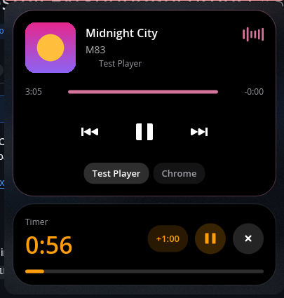

# Dynamic Island para o painel do COSMIC

Applet no estilo da Dynamic Island do iPhone e das Live Activities do macOS: mostra no
painel o que está acontecendo e, ao clicar, se abre nas atividades ao vivo. O visual segue
o padrão dos applets do COSMIC: as cores, os cantos e os espaçamentos do seu tema.


No painel, a ilha mostra a atividade mais importante:

- **mídia**: a capa, o título e barras que dançam na cor de destaque do tema enquanto toca
  (pausadas, elas descansam embaixo); funciona com qualquer player MPRIS: Spotify, navegadores,
  YouTube, VLC, mpv, Rhythmbox… Um player pausado sai da ilha depois de 5 minutos;
- **timer**: a contagem regressiva, com o despertador na cor de aviso do tema. Com música
  tocando, o timer fica ao lado dela, como no iPhone;
- **gravando**: quando algum app grava do microfone (o Gravador de som, uma chamada, o
  OBS…), um ponto vermelho com o tempo de gravação, como o ponto laranja do iPhone; no popup
  aparece quem está gravando, com o nome e o ícone do app;
- **carregando**: ao ligar o carregador, a ilha mostra por um instante "Carregando" e a
  porcentagem em verde;
- **acabou o tempo**: quando o timer termina a ilha avisa, e chega uma notificação.

Sem nada acontecendo, fica só o ícone da ilha, como os outros applets.
O botão do meio do mouse sobre a ilha toca ou pausa a música.

Clicar abre o popup, como o dos applets do COSMIC:



- o **player**: a capa (clicar nela traz a janela do player), o título, o artista, o nome
  do player, as barras, o progresso, que dá para arrastar, com o tempo que passou e o que
  falta, e os botões de anterior, tocar/pausar e próxima. Com mais de um player aberto,
  aparecem os nomes deles para escolher qual mostrar (quem começa a tocar passa à frente);
- o **timer**: botões de 1, 5, 10 e 25 minutos para começar um; rodando, mostra o tempo
  que falta, a barra de progresso, +1:00, pausar e cancelar;
- a **bateria**, enquanto carrega: a porcentagem e quanto falta para encher.

No fim do popup, **Personalizar** abre as opções, que valem para a ilha em todas as telas:

- **no painel**: mostrar ou não a capa, o título da música (com a largura pequena, média ou
  grande) e as barras animadas;
- **atividades**: ligar ou desligar cada uma: mídia, apps gravando, timer e carregamento.

O texto segue o idioma do sistema: português ou inglês.

## Instalar

Precisa do Rust (1.85 ou mais novo) e das bibliotecas de desenvolvimento do libcosmic
(`libxkbcommon`, `wayland`, `pkg-config`…). Depois:

```sh
./install.sh            # em ~/.local
sudo ./install.sh /usr  # para todos os usuários
```

E adicione **Dynamic Island** em Configurações > Área de trabalho > Painel > Applets,
de preferência no centro do painel de cima.

## Flatpak

`flatpak/` tem o manifesto para o repositório Flatpak do COSMIC (a COSMIC Store).
Depois de mudar as dependências, `flatpak/generate-sources.sh` refaz o `cargo-sources.json`.
No Flatpak, as capas de players em outro sandbox (como um navegador em Flatpak) não
aparecem: o arquivo fica no `/tmp` do sandbox do player.

## Desenvolvimento

`COSMIC_ISLAND_PREVIEW=popup` abre a ilha sozinha ao iniciar, `=settings` abre direto em
Personalizar e `=timer` começa um timer de 1 minuto, para tirar capturas de tela sem clicar
no painel (`COSMIC_ISLAND_PREVIEW=timer,popup` faz as duas coisas).

## Licença

GPL-3.0-only.
